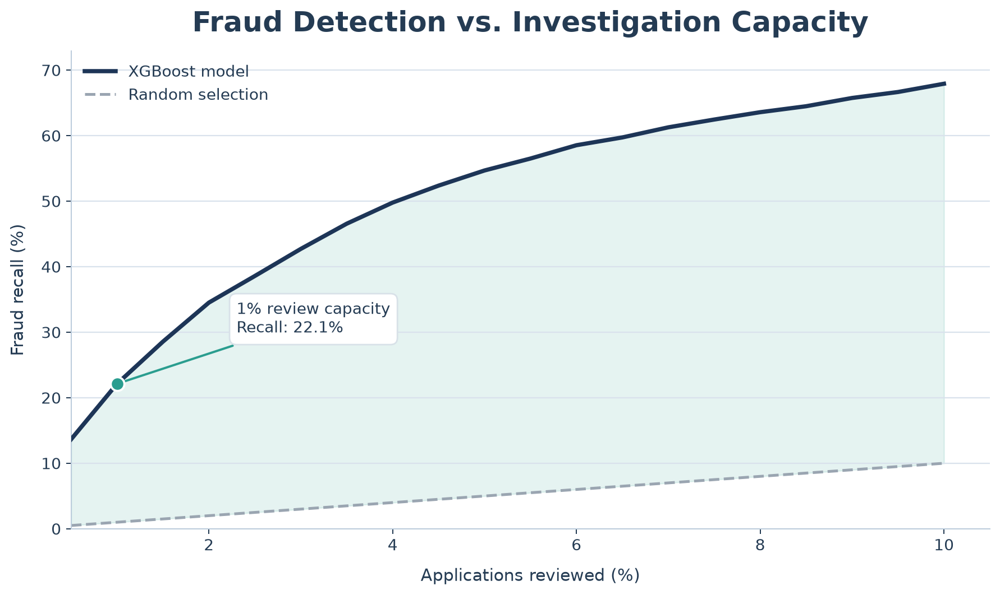
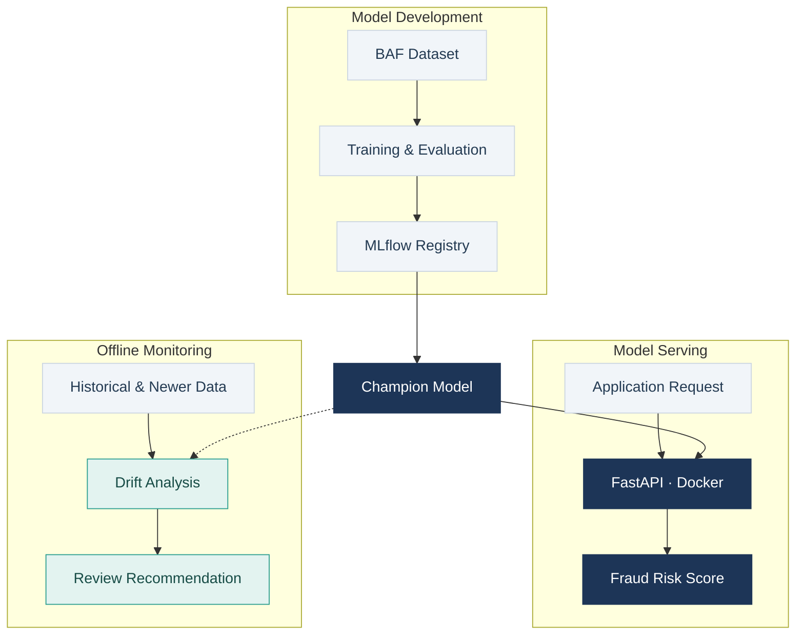
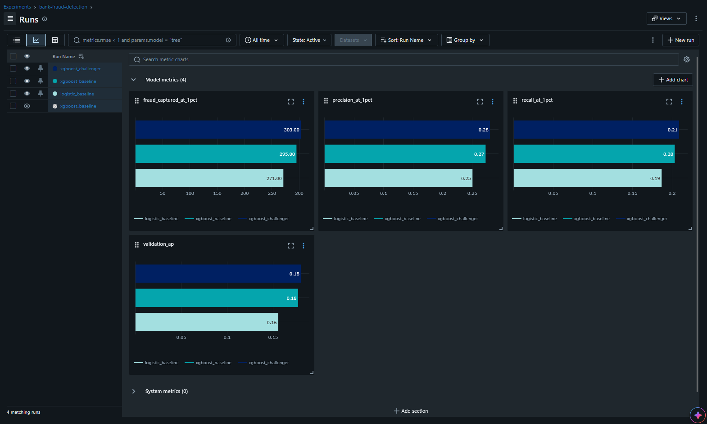
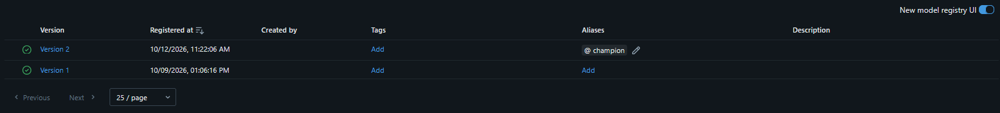
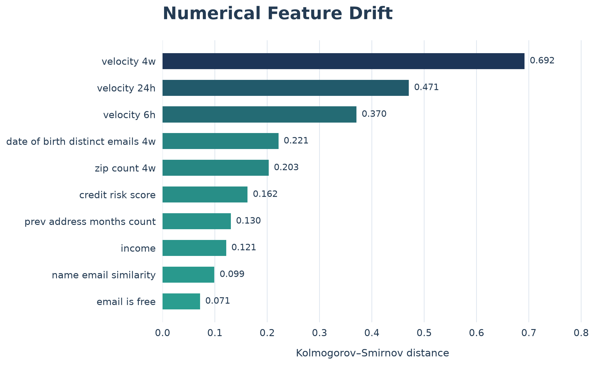

# Bank Account Fraud Detection with Machine Learning and MLOps

I built this project to explore a practical question: **how can a bank decide which account applications to investigate when it cannot review every application?**

Using the [Feedzai Bank Account Fraud (BAF) dataset](https://github.com/feedzai/bank-account-fraud), I trained and compared machine learning models to rank applications by their predicted fraud risk. I also used MLflow to track models, built a FastAPI service to return predictions, and added basic monitoring to detect changes in the data.

## The problem: limited review capacity

A fraud investigation team may receive thousands of applications but only have enough time to review a small part of them.

In this project, **review capacity** means the percentage of applications the team can manually investigate. For example, a capacity of **1%** means the team can review about **1 out of every 100 applications**.

The idea is:

1. The model gives each application a fraud-risk score.
2. We sort the applications from highest to lowest score.
3. If the team's capacity is 1%, we review the highest-scoring 1% first.
4. We evaluate how many actual fraud cases appear in that group.

### Results on the final test month

I selected the final XGBoost model using month 6, then evaluated it on **month 7**, which was not used for model selection.

| Metric | Result |
|---|---:|
| Applications in the test month | 96,843 |
| Actual fraud cases | 1,428 (1.47%) |
| Applications reviewed at 1% capacity | 969 |
| Fraud cases found in those 969 applications | **316** |
| Precision at 1% capacity | **32.61%** |
| Recall at 1% capacity | **22.13%** |
| Average Precision (AP) | **0.21952** |

In other words, by reviewing roughly 1% of applications, we could identify **22.1% of the known fraud cases** in this test dataset. If we reviewed 1% at random, we would expect to find only about **14 fraud cases** out of 1,428.

**Precision** means the percentage of reviewed applications that were actually fraudulent. **Recall** means the percentage of *all* fraud cases we found within the review budget. Average Precision summarizes how well the model ranks fraud cases across different score thresholds.



*Fraud recall as the review budget increases. The dashed line represents random selection; the highlighted point shows the 1% budget on month 7.*

## How the project works



There are two separate parts: the API returns scores for individual applications, while the monitoring code checks whether the overall input data has changed. Monitoring does not automatically retrain or replace the model.

## Data and model training

The project uses the **Base** version of the BAF dataset. I split the data by month rather than randomly, to make the evaluation closer to predicting applications that arrive later.

| Data split | Months | Applications | Used for |
|---|---|---:|---|
| Training | 0–5 | 794,989 | Learning from historical applications |
| Validation | 6 | 108,168 | Comparing models and choosing a candidate |
| Test | 7 | 96,843 | Final evaluation after model selection |

The target is `fraud_bool`, and the `month` column is used to split the data. The preprocessing pipeline handles missing and special values, scales numerical features, and encodes categorical features.

I started with Logistic Regression as a baseline, then trained two XGBoost configurations.

### Model comparison on month 6

| Model | Average Precision | Fraud cases found at 1% capacity | Recall at 1% |
|---|---:|---:|---:|
| Logistic Regression | 0.15568 | 271 | 18.69% |
| XGBoost v1 | 0.17727 | 295 | 20.34% |
| **XGBoost v2** | **0.18032** | **303** | **20.90%** |

Each model was evaluated on the same 108,168 applications, with a budget of 1,082 reviews. XGBoost v2 found **8 more fraud cases** than v1 while reviewing the same number of applications (this is a small improvement and not yet established whether it is statistically significant).



*I used MLflow to keep track of the training runs and compare their validation results.*

## Model versions and the API

I used the MLflow Model Registry to store model versions. The current model has a `champion` alias, so the API can load the selected model without hard-coding its version number.

For a model to be promoted, the project checks two rules: it must find at least five additional fraud cases at 1% review capacity and must not have lower AP. I can then review the decision and choose whether to update the champion alias.



*In my local experiment, version 2 became the champion after meeting the validation rules.*

The prediction service uses **FastAPI** and runs in **Docker**. It accepts one application's features and returns a fraud-risk score obtained by the champion model. You can try it in the interactive documentation at http://127.0.0.1:8000/docs while the service is running.

Example request in PowerShell:

```powershell
Invoke-RestMethod `
  -Uri "http://127.0.0.1:8000/predict" `
  -Method POST `
  -ContentType "application/json" `
  -InFile "examples/application.json"
```

Example response:

```json
{
  "fraud_probability": 0.00168590375687927,
  "model": "models:/bank-fraud-risk@champion"
}
```


## Monitoring changes in the data

A model is trained using past applications, but future applications may look different. This is called **data drift**. Detecting it helps us decide whether to investigate the data or check the model's performance again.

The project compares months 0–5 with month 6 and measures:

- **KS statistic:** differences between the distributions of numerical features.
- **Total Variation Distance (TVD):** differences between categorical distributions.
- **Missing-value changes:** whether features have more or fewer missing values.
- **Prediction-score drift:** whether the distribution of model scores has changed.



*The numerical features with the largest distribution changes between the historical reference and month 6.*

I also added a simple rule to recommend investigation when numerical KS is above **0.20**, categorical TVD is above **0.10**, or the missing-value rate changes by more than **5 percentage points**.

The most recent feature comparison produced `review_recommended`, with five numerical features above the KS threshold:

| Feature | KS statistic |
|---|---:|
| `velocity_4w` | 0.692 |
| `velocity_24h` | 0.471 |
| `velocity_6h` | 0.370 |
| `date_of_birth_distinct_emails_4w` | 0.221 |
| `zip_count_4w` | 0.203 |

This means the data changed enough to deserve a closer look. A real team could check the feature pipeline and evaluate new labeled applications before deciding whether to train another model..

The monitoring reports are saved in `reports/`, and monitoring results can also be logged to MLflow.

## How to run the project

These commands are for **Windows PowerShell**. You'll need Python 3.11, Docker Desktop with Compose, and the `Base.csv` file from the [BAF dataset](https://github.com/feedzai/bank-account-fraud). Run them from the project folder. The dataset and local MLflow files are not included in Git.

### 1. Install dependencies and add the dataset

```powershell
python -m venv .venv
.\.venv\Scripts\Activate.ps1
python -m pip install -r requirements-dev.txt
New-Item -ItemType Directory -Path data -Force | Out-Null
# Save the BAF Base dataset as data/Base.csv
```

### 2. Start MLflow

On a fresh setup, create the database file before starting Docker. Don't overwrite it if it already exists.

```powershell
if (-not (Test-Path mlflow.db)) {
    New-Item -ItemType File -Path mlflow.db | Out-Null
}
New-Item -ItemType Directory -Path mlartifacts -Force | Out-Null

docker compose up -d --build mlflow
```

Open MLflow at http://127.0.0.1:5000.

### 3. Train the baseline models and register the first champion

```powershell
python -m src.train --model logistic
python -m src.train --model xgboost
```

The second command prints an MLflow model URI. Use your own URI in the next two commands

```powershell
python -m src.register_model --model-uri "models:/m-YOUR_MODEL_ID"
python -m src.register_model --model-uri "models:/m-YOUR_MODEL_ID" --apply
```

The first command only checks what would happen. The second registers the model and assigns the first champion alias. Skip this initialization if your MLflow registry already has a champion.

### 4. Start and test the API

```powershell
docker compose up -d api
Invoke-RestMethod -Uri "http://127.0.0.1:8000/health"
```

Use http://127.0.0.1:8000/docs or send the example `/predict` request shown earlier.

### 5. Train a challenger and compare it with the champion

```powershell
python -m src.train_challenger
Get-Content reports/promotion_decision.json
python -m src.promotion  # check without changing the champion
```

Only if you want to promote an eligible challenger:

```powershell
python -m src.promotion --apply
docker compose restart api
python -m src.verify_model
```

Training a challenger does not automatically switch the deployed model.

### 6. Run monitoring and tests

```powershell
python -m src.monitor                # feature drift and review recommendation
python -m src.monitor --with-scores  # include prediction-score monitoring and MLflow logging
python -m pytest -q
```

The repository also contains a GitHub Actions workflow to run tests when code is pushed or a pull request is opened.

## Main project files

| Location | What it does |
|---|---|
| `src/train.py`, `src/train_challenger.py` | Train the baseline models and new candidates |
| `src/data.py`, `src/preprocessing.py`, `src/modeling.py` | Prepare data and build model pipelines |
| `src/evaluation.py`, `src/promotion.py`, `src/register_model.py` | Evaluate models and manage champion selection |
| `src/api.py`, `src/schemas.py` | Serve predictions and validate API inputs |
| `src/monitor.py` | Measure data changes and create monitoring reports |
| `tests/` | Automated tests |
| `reports/` | Evaluation results and charts |
| `docs/images/` | MLflow screenshots |
| `Dockerfile`, `compose.yaml` | Docker setup |

## Limitations

This project is a local demonstration using synthetic data, so the results may not represent how the models would perform on real banking applications.

The model was evaluated under a limited review capacity, but the review process itself is not implemented. The API can generate individual fraud-risk scores, although it is not connected to an actual investigation system.

There are also some limitations in the evaluation and monitoring. The model's predicted probabilities have not been calibrated, and the improvement between the two XGBoost versions has not been tested for statistical significance.

## Future Work

There are some improvements I like to explore:

• Batch predictions and review prioritization: Extend the API to score multiple applications and generate a ranked list based on the available investigation capacity.

• Automated monitoring: Run drift checks periodically and generate alerts when important changes are detected.

• Model calibration: Evaluate whether the predicted probabilities reflect actual fraud rates and apply calibration methods if necessary.


• Interactive interface: Build a simple dashboard to explore predictions, investigation capacity, and monitoring results.

These additions could make the project closer to a practical fraud detection system, while keeping human review as part of important decisions.